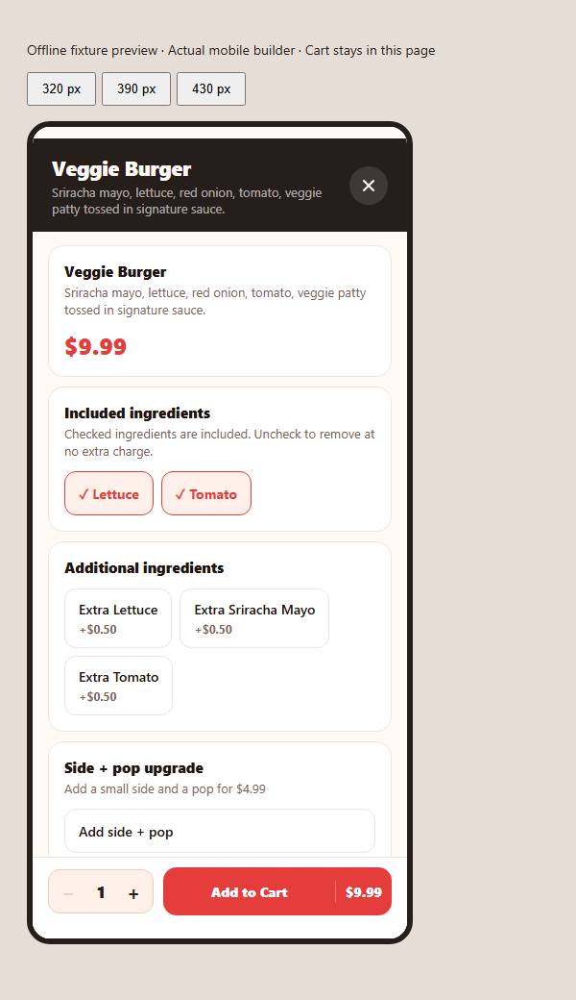
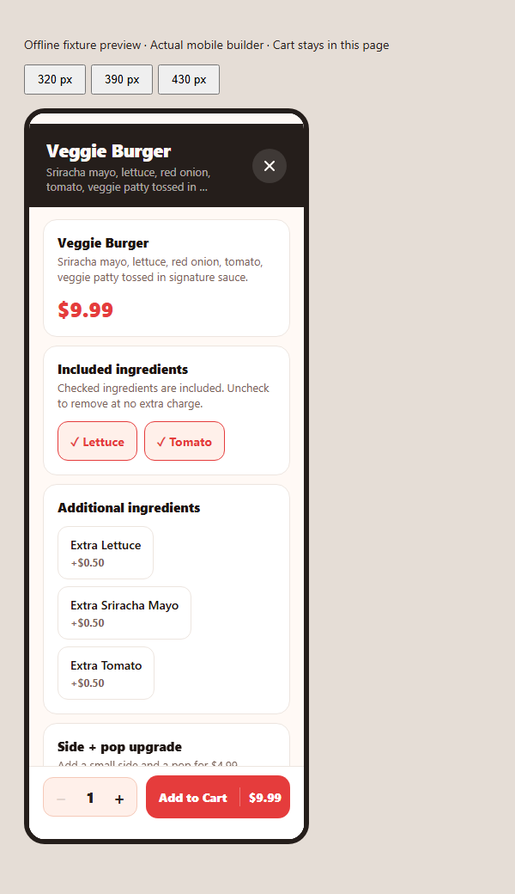

# Wings4U non-wing customization completion report

Branch: `fix/non-wing-customization-parity`. Base: local `main` at `7e020fd`. The initial checkout had only untracked `.expo/` and `tsconfig.json`; both were preserved and excluded from this change. No merge or deployment was performed.

## Result and production boundary

The implementation is ready for review. Web, mobile and server quote/checkout now share authoritative customization rules. The mobile generic builder uses the existing Wings Builder shell and step cards. Dedicated Wings and Wing Combo builder implementations and routing are preserved; the shell's optional compact footer affects only the generic builder.

Production menu corrections are **NOT EXECUTED**. In particular, live Veggie Burger avocado is explicitly configured as `__always__`. It remains eligible until the owner approves removing/deactivating that incorrect catalog record. Code intentionally does not hide ingredient names or silently reinterpret explicit item authorization.

See [read-only findings and exact correction IDs](non-wing-catalog-remediation-NOT-EXECUTED.md), [menu-only evidence](non-wing-catalog-readonly.json), and [commented proposed SQL](non-wing-catalog-proposed-NOT-EXECUTED.sql).

## Root causes

- The old web fallback accepted extras based on Add/Extra prefixes and a broad token allowlist. Empty recipe lists passed. Already-selected options bypassed checks, and size matching could return before ingredient authorization.
- Mobile displayed linked groups without equivalent eligibility rules.
- The current database has duplicate option rows: Buffalo Chicken Wrap has two active standalone jalapeno choices under the same Extras group. Five other products show the same pattern. Composite item/group mapping keys themselves are not duplicated. The exact historical writer cannot be established from current catalog records alone.
- Admin converted legacy null mappings into Always available when flattening group options. An unrelated save could then promote them to explicit authorization and recreate option IDs.
- Seed and builder-sync definitions contained discontinued standalone avocado/jalapeno additions. Their future creation definitions are corrected; neither process ran.

## Architecture and parity

Admin removable ingredients and additional ingredients persist through Prisma item/group/option relations. Catalog serialization now includes actual option ordering and a server-issued item scope derived from the complete group relation set. An exclusively linked group may use explicit `__always__`; a shared group cannot globally authorize off-recipe extras. Dedicated Additional Ingredients configuration overrides older Extras groups.

`@wings4u/customization` contains pure TypeScript rules for authorization, exact normalized ingredient matching, size eligibility, ordering, defaults, min/max constraints, semantic duplicates, conflicts, stale selections and modifier totals. Equivalence retains size words, placement meaning, ingredient scope and flavour identity. Required selections and repeated flavour slots are preserved. Equal-price equivalent optional extras use a deterministic canonical option ID and report all source IDs; competing prices or reused IDs are reported and excluded.

Both customer clients use the same catalog transformation. Server builder validation adapts current Prisma rows into the same inputs before quote/checkout, rejecting unauthorized, inactive, duplicate, stale or wrong-size option IDs. Mapping sort order is used consistently on both sides. Server prices remain authoritative. Existing promotion, tax, loyalty, delivery, coupon and payment calculation semantics were not changed.

The cart payload retains real API option IDs, product IDs and removal IDs. Side/pop upgrades retain the established `ITEM_CUSTOMIZATION.side_pop_bundle` contract with exactly one 499-cent charge. That existing backend contract uses side/drink labels rather than separate modifier IDs; the implementation does not invent identifiers or add a second modifier charge. Its fixed choices/pricing are centralized and shared with backend validation.

## Mobile behavior

The generic builder uses the charcoal header, cream background, white rounded StepCards, red accents, peach checked states, quantity controls, live totals and sticky Add to Cart/Update Cart footer. The shared shell continues providing safe-area and keyboard handling. A compact generic footer fits narrow screens without changing dedicated wing footers.

Size groups precede included ingredients. Checked ingredients mean included; unchecking submits real removal IDs at no additional cost. Extras and required choices appear only when applicable. Notes and quantity are preserved when editing. Optional single selections can be cleared. Defaults and current selection limits follow shared rules.

Burger/wrap side-and-pop upgrades are supported. Lunch child selection excludes helper products, preserves the selected child, ingredients, extras and customer notes, and strips generated summaries from either platform when editing. Missing/deleted children require a new selection rather than silently substituting another product. Existing customized cart lines are replaced rather than duplicated.

All generic categories use the same data-driven builder, including tenders/combos, salads, poutines/fries, sides, appetizers, breads, desserts, drinks and dips when configured. Plain products retain quick-add; eligible upgrades, tender/lunch workflows, ingredients, instructions and modifier requirements open customization. Admin Additional Ingredients editing is available for all non-wing categories.

Stale IDs, ingredient removals, changed saved prices and invalid bundle choices produce review/error behavior. Hidden selections cannot silently remain charged. Customers must review or reselect before updating an invalid cart. Existing order records are retained.

## Admin synchronization

Existing post-transaction location cache invalidation, `catalog.updated` emission and optional Next tag revalidation remain in use. The Redis catalog format version is bumped, and Next catalog requests carry a new format header. Next cache has a 30-second fallback revalidation bound if the configured admin callback is unavailable; when configured, explicit tag invalidation remains immediate.

Mobile refetches when returning to the focused menu, on existing navigation refresh keys, on pull-to-refresh and on order-context changes. Active generic builders resolve their product from refreshed menu data, preserving in-progress selections for validation. Web refreshes on return to focus/visibility, without polling. The staff-only realtime orders channel is not exposed to customers.

Unchanged admin extras retain their linked groups and option IDs. Legacy unconfigured mappings are displayed as requiring review, and changing them requires an explicit recipe mapping or item approval. Unchanged removable ingredients retain their IDs across saves. Genuine catalog changes invalidate stale cart configurations through the existing quote/checkout error flow.

## Validation

| Check | Result |
|---|---|
| API unit/integration suites, mocked persistence/providers | 944 tests, 54 suites passed |
| Mobile tests, including dedicated Wings/Wing Combo, cart, reorder and generic add/edit | 493 tests, 42 suites passed |
| Web tests, including shared fixtures and admin authorization regression | 95 tests, 12 suites passed |
| Pure shared-rule fixtures | 19 tests passed |
| TypeScript: shared package, API, web and mobile | Passed |
| API production build | Passed; Prisma client generation only, no DB connection/migration |
| Next production build | Passed, 51 static pages; local build workers limited using `CIRCLE_NODE_TOTAL=3` after a Windows spawn failure at default parallelism |
| Android JavaScript export | Passed with `--no-bytecode --max-workers 2` |
| iOS JavaScript export | Passed with `--no-bytecode --max-workers 2` |
| Seed/sync syntax verification | Transpiled only; neither script executed |
| Layout | Offline React Native Web preview at 390px and 320px; screenshots attached |

Build commands used an outbound-socket-blocking preload and left environment connections unchanged. Expo used offline mode. No replacement database was created. Production inspection was a separate PostgreSQL-enforced read-only transaction over menu tables only. API test provider logs describe mocks, not real emails, orders or payments.

New package build hooks cover API/web build/dev/test and mobile start/platform/test scripts. Pure rule tests: `npm run test:customization`. Offline visual preview: `npm run build:customization`, then `node packages/customization/preview.cjs` (fixture cart only; network calls disabled).

## Remaining owner and manual QA work

- Approve and apply the catalog remediation separately: 20 unstocked option records, 35 other authorization candidates, six duplicate sets, two recipe/description review questions and the lunch-tender dip question. No prices or missing ingredient records were invented.
- Verify the admin revalidation URL/secret configuration in the deployment environment. Direct SQL changes require explicit cache/tag invalidation; they do not emit admin events automatically.
- Perform native-device safe-area, keyboard, accessibility and full kitchen/order-flow QA using an approved test environment. JavaScript exports are not native signed builds or device tests. No customer order/payment was submitted.
- The existing fixed side/pop label contract is preserved; introducing dynamically stocked bundle modifier IDs would require a separate backend/catalog contract change.
- Dedicated wing builders retain their existing internal salad presentation helpers; this change applies shared eligibility to standalone non-wing customization and lunch children without redesigning wing workflows.
- The browser and Windows automation tools failed before connecting (`sandboxPolicy` configuration error). Offline screenshots were obtained with a separate headless Edge profile. No authenticated production UI was opened.

## Exact changed files

The file list below is generated from this branch's reviewed diff, including the accompanying audit artifacts.

- `Docs/audits/non-wing-catalog-proposed-NOT-EXECUTED.sql`
- `Docs/audits/non-wing-catalog-readonly.json`
- `Docs/audits/non-wing-catalog-remediation-NOT-EXECUTED.md`
- `Docs/audits/non-wing-customization-completion.md`
- `Docs/audits/non-wing-mobile-320.png`
- `Docs/audits/non-wing-mobile-390.png`
- `apps/api/package.json`
- `apps/api/src/modules/admin/admin-menu.service.spec.ts`
- `apps/api/src/modules/admin/admin-menu.service.ts`
- `apps/api/src/modules/catalog/catalog-cache.service.spec.ts`
- `apps/api/src/modules/catalog/catalog-cache.service.ts`
- `apps/api/src/modules/catalog/catalog.service.ts`
- `apps/api/src/modules/orders/reorder-preview.spec.ts`
- `apps/api/src/modules/shared/builder-catalog-validation.ts`
- `apps/api/src/modules/shared/customization-rules.spec.ts`
- `apps/api/src/modules/shared/order-validation.ts`
- `apps/api/src/modules/shared/ordering-integrity.spec.ts`
- `apps/api/src/modules/shared/ordering-service-parity.spec.ts`
- `apps/api/src/modules/shared/pricing.ts`
- `apps/application/package.json`
- `apps/application/src/components/menu-item-builder.tsx`
- `apps/application/src/components/mobile-builder-shell.tsx`
- `apps/application/src/lib/popular-items.ts`
- `apps/application/src/lib/types.ts`
- `apps/application/src/screens/menu-screen.tsx`
- `apps/application/tests/footer-promotional-screen.test.cjs`
- `apps/application/tests/menu-item-builder-edit.test.cjs`
- `apps/application/tests/popular-items.test.cjs`
- `apps/web/package.json`
- `apps/web/src/Wings4u/components/menu-page.tsx`
- `apps/web/src/app/admin/menu/menu-item-modal.tsx`
- `apps/web/src/components/item-customization-overlay.tsx`
- `apps/web/src/components/item-modal.tsx`
- `apps/web/src/components/lunch-special-builder.tsx`
- `apps/web/src/lib/cart-item-utils.ts`
- `apps/web/src/lib/catalog/server-catalog.ts`
- `apps/web/src/lib/menu-item-customization.ts`
- `apps/web/src/lib/types.ts`
- `apps/web/tests/admin-customization-integrity.test.cjs`
- `apps/web/tests/customization-parity.test.cjs`
- `package-lock.json`
- `package.json`
- `packages/customization/audit-catalog.cjs`
- `packages/customization/offline-validation.cjs`
- `packages/customization/package.json`
- `packages/customization/preview.cjs`
- `packages/customization/src/index.ts`
- `packages/customization/test/fixtures.cjs`
- `packages/customization/test/rules.test.cjs`
- `packages/customization/tsconfig.json`
- `packages/database/prisma/seed.ts`
- `packages/database/prisma/sync-builder-config.ts`
